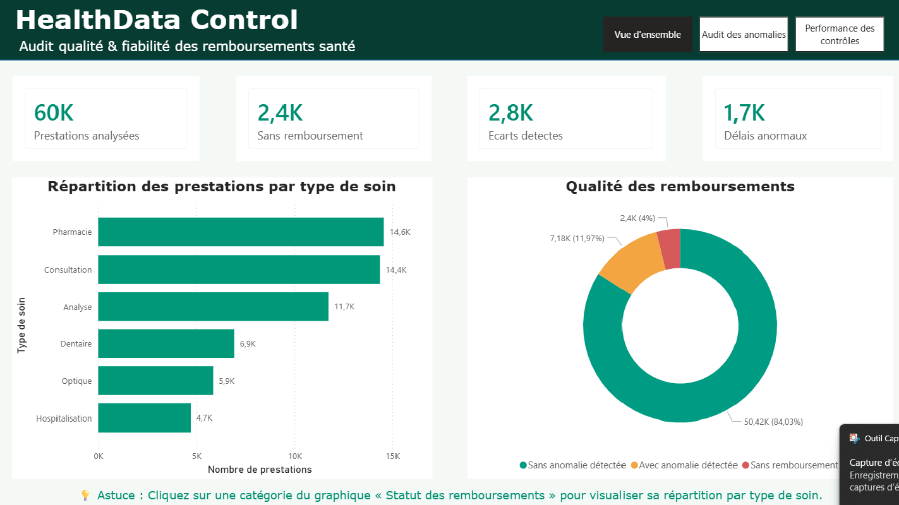
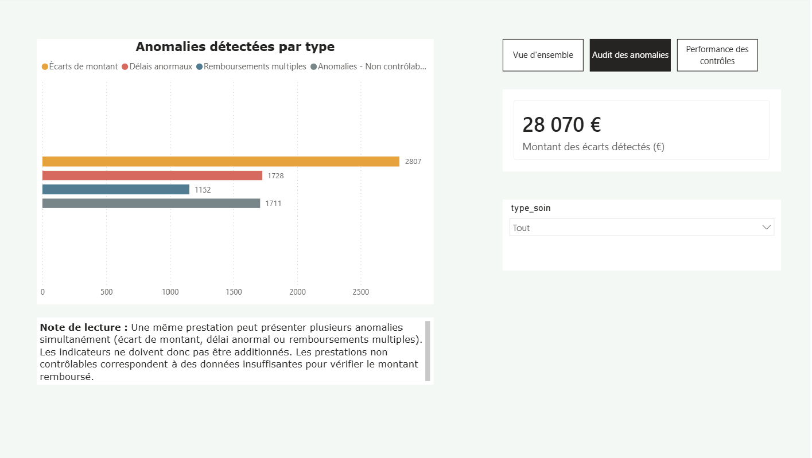
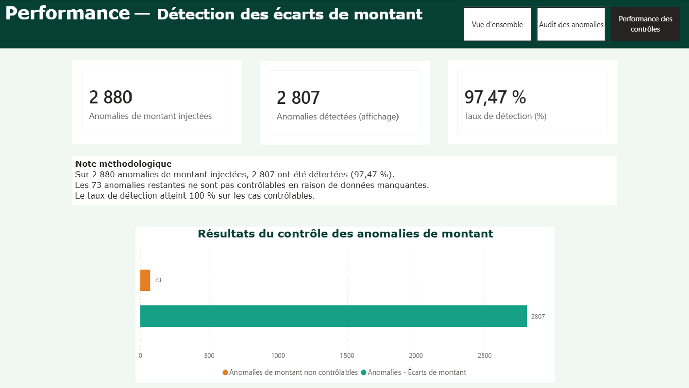

# HealthData Control

### Automatisation du contrôle qualité et de la fiabilité des remboursements santé

**Projet Data Analyst | Python • SQL • Excel • Power BI**

---

## Présentation du projet

**HealthData Control** simule une mission ponctuelle d'audit externe
pour une mutuelle santé.

L'objectif est de contrôler la qualité des données de prestations
et de remboursements, d'identifier les anomalies financières
et de produire des résultats mesurables et vérifiables.

Le projet repose sur un pipeline automatisé en Python,
une base de données SQLite et un tableau de bord Power BI.

Les contrôles sont évalués à partir d'une vérité terrain
(ground truth) connue, permettant de mesurer la fiabilité
de la détection des écarts de montant.

**Période analysée : septembre 2025 à août 2026.**

> Toutes les données sont synthétiques. Le projet constitue
> une démonstration technique et non un audit réalisé
> pour une véritable mutuelle.

---

## Objectifs

- Automatiser la validation et le nettoyage des fichiers Excel.
- Détecter les doublons et les données manquantes.
- Identifier les incohérences et les anomalies.
- Rapprocher les prestations et les remboursements.
- Détecter les écarts financiers et les délais anormaux.
- Tracer les corrections effectuées.
- Centraliser les données dans une base SQLite.
- Produire des indicateurs de suivi dans Power BI.

---

## Volumes traités

- **10 000 adhérents** simulés.
- **61 200 prestations brutes**, dont 1 200 doublons injectés.
- **60 000 prestations uniques** après déduplication.
- **58 752 lignes de remboursements** traitées.
- **12 mois de données** : septembre 2025 à août 2026.

---

## Résultats de l'audit

### Synthèse des contrôles

| Indicateur | Résultat |
|---|---:|
| Prestations sans anomalie détectée | 50 420 (84,03 %) |
| Prestations avec au moins une anomalie détectée | 7 180 (11,97 %) |
| Prestations sans remboursement | 2 400 (4 %) |
| Écarts de montant détectés | 2 807 |
| Somme des écarts de montant (valeur absolue) | 28 070 € |
| Délais de remboursement anormaux | 1 728 |
| Remboursements multiples | 1 152 |
| Prestations non contrôlables | 1 711 |

> **Note de lecture :** Les 7 180 prestations avec au moins
> un signal détecté incluent les prestations non contrôlables
> (type de soin manquant).
>
> Ces dernières correspondent à un problème de qualité
> des données, et non nécessairement à une anomalie financière.
>
> Les catégories de contrôle peuvent se chevaucher :
> une prestation présentant plusieurs signaux n'est
> comptabilisée qu'une seule fois dans ce total.

### Fiabilité de la détection des écarts de montant

| Indicateur | Résultat |
|---|---:|
| Anomalies de montant injectées | 2 880 |
| Anomalies correctement détectées | 2 807 |
| Anomalies non contrôlables | 73 |
| Faux positifs détectés | 0 |
| Rappel global | 97,47 % |
| Rappel sur les cas contrôlables | 100 % |
| Précision sur les écarts de montant | 100 % |

> **Note sur les données non contrôlables :**
> 1 711 prestations remboursées ne disposent pas d'un type
> de soin exploitable.
>
> Parmi elles, 73 contiennent un écart de montant injecté
> qui ne peut pas être détecté automatiquement.
>
> Cela explique la différence entre les 2 880 anomalies
> de montant injectées et les 2 807 anomalies détectées.

**Méthode de vérification :**

Les anomalies détectées ont été comparées à la vérité terrain
(ground truth) par identifiant unique de prestation
(`id_prestation`).

Les 73 anomalies non détectées correspondent à des prestations
dont le montant attendu ne pouvait pas être calculé.

Aucune anomalie de montant inexpliquée n'a été constatée.

**Important :** les mesures de précision et de rappel concernent
uniquement les écarts de montant. Les autres catégories d'anomalies
n'ont pas fait l'objet de la même vérification individuelle.

Ces résultats ont été obtenus sur des données synthétiques
et ne constituent pas une garantie de performance
sur des données réelles.

---

## Architecture du pipeline

Le projet reproduit un processus de contrôle des données
de prestations et de remboursements santé.

### Chaîne de traitement
```text
Fichiers Excel (données synthétiques)
        |
        v
Validation des fichiers
        |
        v
Détection des erreurs et des doublons
        |
        v  
Rejet et nettoyage des données
        |
        v
Nouvelle validation
        |
        v
Rapprochement prestations / remboursements
        |
        v
Détection des anomalies et calcul des indicateurs
        |
        v
Centralisation dans SQLite
        |
        v
Visualisation dans Power BI
```

### Technologies utilisées

| Technologie | Utilisation |
|---|---|
| Python | Automatisation des traitements |
| pandas | Nettoyage, validation et rapprochement |
| Excel | Fichiers d'entrée et rapports de contrôle |
| SQLite | Stockage structuré des données |
| Power BI | Tableaux de bord et indicateurs |
| Git / GitHub | Versionnement et présentation du projet |

---

## Règles métier et contrôles

Le pipeline applique plusieurs règles pour identifier
les anomalies dans les prestations et les remboursements.

| Contrôle | Règle appliquée |
|---|---|
| Doublons stricts | Détection et suppression des lignes identiques |
| Doublons divergents | Identification des conflits sur `id_prestation` nécessitant une vérification humaine |
| Données manquantes | Identification et traçabilité des champs incomplets |
| Montant attendu | Calcul à partir du montant facturé et du taux de remboursement associé au type de soin |
| Écart de montant | Signalement des différences dépassant une tolérance de ±2 € |
| Délai anormal | Signalement des remboursements dépassant 30 jours |
| Remboursements multiples | Détection de plusieurs remboursements associés à une même prestation |
| Absence de remboursement | Identification des prestations sans remboursement correspondant |

### Gestion des cas non contrôlables

Lorsqu'un type de soin est manquant, la valeur
`A_VERIFIER` est utilisée pour signaler le problème.

Le montant attendu ne peut alors pas être calculé
de manière fiable.

Ces prestations sont identifiées comme
**non contrôlables** et exclues du calcul des écarts
de montant, dans l'attente d'une vérification humaine.

### Traçabilité

Les contrôles permettent de distinguer :

- Les données valides.
- Les doublons stricts supprimés.
- Les conflits nécessitant une intervention humaine.
- Les données corrigées automatiquement.
- Les anomalies métier détectées.
- Les prestations non contrôlables.

---

## Méthodologie de vérification

### 1. Création d'une vérité terrain

Le jeu de données synthétiques contient des anomalies
volontairement injectées et répertoriées dans le fichier
`ground_truth_anomalies.csv`.

Cette vérité terrain permet de comparer les résultats
du pipeline aux anomalies réellement présentes.

### 2. Détection indépendante

Le script `reconcile_claims.py` détecte les anomalies
à partir des données de prestations et de remboursements.

La vérité terrain n'est chargée qu'après les traitements
de détection, pour effectuer la vérification finale.

Cette séparation évite d'utiliser les réponses attendues
pour déterminer les anomalies.

### 3. Comparaison par identifiant

Pour les écarts de montant, la comparaison est effectuée
par `id_prestation`, et non uniquement sur les totaux.

Elle permet d'identifier :

- Les anomalies correctement détectées.
- Les anomalies injectées mais non détectées.
- Les faux positifs.
- Les cas non contrôlables.

### 4. Périmètre de validation

La comparaison individuelle avec la vérité terrain
a été réalisée pour les écarts de montant.

Pour les délais anormaux et les remboursements multiples,
les volumes détectés sont cohérents avec les volumes
injectés, mais leur correspondance individuelle
n'a pas été vérifiée selon la même méthode.

Ces résultats ne permettent donc pas d'affirmer
une précision ou un rappel de 100 % pour ces catégories.

---

## Limites du projet

Ce projet constitue une démonstration technique réalisée
à partir de données entièrement synthétiques.

### 1. Données simulées

Les prestations, remboursements et anomalies ont été
générés artificiellement.

Les résultats ne reflètent donc pas les performances
obtenues dans une véritable mutuelle santé.

### 2. Règles de détection connues

Le générateur de données et le système de détection
reposent sur les mêmes règles métier, notamment
les taux de remboursement par type de soin
et la tolérance de ±2 €.

Le rappel de 100 % sur les anomalies de montant
contrôlables est donc en partie favorisé par
la construction du jeu de données.

Il ne peut pas être généralisé à des données réelles.

### 3. Gestion des fichiers rejetés

Dans cette version, un fichier contenant des doublons
peut être rejeté dans son intégralité.

Cette approche sécurise le traitement, mais nécessiterait
une gestion plus fine des rejets dans un environnement
de production.

### 4. Conflits nécessitant une intervention humaine

Les doublons divergents présentant un même
`id_prestation` avec des informations contradictoires
ne sont pas corrigés automatiquement.

Ils nécessitent une vérification et une décision humaine
avant leur réintégration.

### 5. Perspectives d'amélioration

Une mise en production nécessiterait notamment :

- Des tests sur des données réelles anonymisées.
- Une validation des règles métier avec les équipes concernées.
- Une gestion des rejets à la ligne plutôt qu'au fichier.
- Des contrôles de sécurité et d'accès adaptés.
- Une évaluation indépendante des différentes catégories
  d'anomalies.
---

## Tableaux de bord Power BI

Le projet comprend trois pages interactives permettant
de visualiser les résultats des contrôles qualité
et de l'audit des remboursements.

### 1. Vue d'ensemble

Présentation des volumes analysés, des principaux
indicateurs et de la répartition des prestations.



### 2. Audit des anomalies

Analyse des écarts de montant, des remboursements
multiples, des délais anormaux et des données
non contrôlables.



### 3. Performance des contrôles

Évaluation de la fiabilité de la détection des écarts
de montant à partir des anomalies injectées.



---

## Structure du projet

```text
healthcare-reporting-automation/
│
├── 01_data/
│   ├── incoming/           # Données reçues
│   ├── processed/          # Données validées
│   ├── rejected/           # Fichiers rejetés
│   ├── archive/            # Archives
│   └── reports/            # Rapports de contrôle
│
├── 02_python/
│   ├── generate_client_data.py
│   ├── validate_files.py
│   ├── clean_rejected_files.py
│   ├── duplicate_control.py
│   ├── reconcile_claims.py
│   ├── build_database.py
│   └── test_duplicates.py
│
├── 03_database/
└── healthcare.db          # Générée par build_database.py (non publiée)
│
├── 04_power_bi/
│   ├── HealthData_Control_Dashboard.pbix
│   └── screenshots/
│       ├── 01_vue_ensemble.png
│       ├── 02_audit_anomalies.png
│       └── 03_performance_controles.png
│
├── .gitignore
├── README.md
└── requirements.txt
```

Les données de travail sont séparées des scripts Python,
de la base SQLite et des tableaux de bord Power BI.

Cette organisation facilite la maintenance, la traçabilité
des traitements et la réutilisation du pipeline.

---
## Installation

**Prérequis :** Python 3.11 et Power BI Desktop
(pour consulter ou modifier le tableau de bord).

Depuis la racine du projet, créer un environnement virtuel :

```powershell
python -m venv .venv
```

Activer l'environnement virtuel sous Windows PowerShell :

```powershell
.\.venv\Scripts\Activate.ps1
```

Installer les dépendances Python :

```powershell
python -m pip install -r requirements.txt
```

## Exécution du pipeline

Les commandes suivantes sont à exécuter depuis
la racine du projet.

### 1. Génération des données synthétiques

```powershell
python 02_python/generate_client_data.py
```

### 2. Validation des fichiers

```powershell
python 02_python/validate_files.py
```

Les fichiers conformes sont transférés dans `processed/`.
Les fichiers présentant des erreurs sont placés dans `rejected/`.

### 3. Correction des fichiers rejetés (si nécessaire)

Pour un fichier de prestations rejeté :

```powershell
python 02_python/clean_rejected_files.py prestations_2025_09_2026_08.xlsx
```

Le fichier corrigé est replacé dans `incoming/`.

Relancer ensuite la validation :

```powershell
python 02_python/validate_files.py
```

Les conflits nécessitant une décision humaine ne doivent
pas être corrigés automatiquement.

### 4. Rapprochement des remboursements

```powershell
python 02_python/reconcile_claims.py
```

Cette étape nécessite les fichiers de prestations
et de remboursements validés.

### 5. Création de la base SQLite

```powershell
python 02_python/build_database.py
```

Cette étape nécessite les trois fichiers validés :
adhérents, prestations et remboursements.

### 6. Visualisation Power BI

Ouvrir le fichier :

`04_power_bi/HealthData_Control_Dashboard.pbix`

Le tableau de bord présente les résultats des contrôles,
les anomalies détectées et les indicateurs de performance.

### 7. Tests des doublons (optionnel)

Pour exécuter les tests du module de détection
des doublons :

```powershell
python 02_python/test_duplicates.py

---

## Compétences démontrées

Ce projet illustre plusieurs compétences directement
applicables aux besoins des assurances et mutuelles santé.

- **Automatisation Python :** traitement de fichiers Excel
  et automatisation de contrôles récurrents.
- **Qualité des données :** détection des doublons,
  identification des valeurs manquantes et traçabilité
  des corrections.
- **Rapprochement de données :** comparaison des prestations
  et des remboursements, identification des écarts.
- **Contrôle des anomalies :** application de règles métier
  et identification des dossiers nécessitant une vérification.
- **SQLite :** structuration et centralisation des données.
- **Power BI :** création de tableaux de bord et suivi
  des indicateurs de contrôle.
- **Validation des résultats :** comparaison avec une vérité
  terrain et mesure de la fiabilité de la détection.

## À propos

**Data Analyst freelance – Assurance et mutuelles santé**

J'interviens sur des missions ponctuelles de contrôle qualité
des données, de rapprochement des prestations et remboursements,
et de mesure de la fiabilité des contrôles.

Mon objectif est d'aider les équipes opérationnelles à fiabiliser
leurs données et à automatiser les traitements manuels récurrents
qui ne sont pas prioritaires pour les équipes informatiques internes.

**Contact :** [Mon profil LinkedIn](https://www.linkedin.com/in/carole-alain/)

